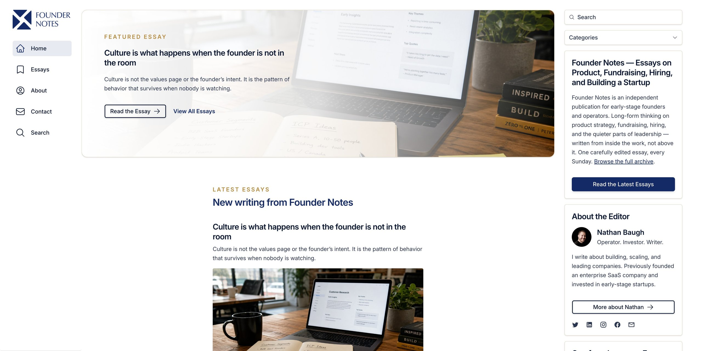

# Winx

[](https://winx.gallop.software)

A modern, AI-built blog and publishing template for writers, journalists, and content creators. Keep WordPress as your editor and authoring backend, then ship a blazing-fast headless Next.js front end that publishes at the speed of thought, outshines the competition, and ranks #1 on Google.

**🌐 Demo:** [winx-cloudflare.gallop.software](https://winx-cloudflare.gallop.software/) (press **Try the admin toolbar** to explore the admin side with made-up data)  
**🎨 Template:** [gallop.software/templates](https://gallop.software/templates)  
**📦 Repository:** [github.com/gallop-software/winx](https://github.com/gallop-software/winx)  
**🏷️ Category:** Headless WordPress Blog Template

---

## Why Use Gallop Templates?

Keep the WordPress editor you already know — but escape the slow themes, plugin sprawl, and clunky front end. Winx goes **headless**: WordPress handles authoring, and a modern Next.js front end handles the experience your readers actually see. Just chat with AI inside our Gallop AI Editor, describe the post, layout, or feature you want, and AI writes the code. No page builders, no endless options fields, and no design limitations. Build beautiful article layouts, add smooth reading animations, configure your SEO and AI discoverability instantly, expand endlessly, and get prompting tips from our [Gallop community](https://gallop-software.slack.com/). Go live in minutes.

[](https://gallop.software/#learn-more)

---

## Features

- 🚀 **Next.js 16.2** with App Router
- ⚛️ **React 19** for cutting-edge performance
- 🎨 **Tailwind CSS 4.2** for pixel-perfect design
- 🔌 **Headless WordPress** - Keep WordPress as your authoring backend and serve a fast, decoupled Next.js front end
- 📚 **Rich blog archives** - Category, tag, author, and year pages built in
- 🗺️ **Auto-generated sitemaps** for pages, posts, authors, categories, and tags
- 🖼️ **Image processing** with automatic optimization
- 🔍 **Built-in search** over the full text of every post, with Algolia Autocomplete
- 🔦 **Lightbox galleries** for post images and media
- 🎞️ **Swiper carousels** for image galleries and sliders
- 💬 **Threaded comments** saved in WordPress, with replies by email
- ❤️ **Post likes & share counts** stored in Cloudflare D1
- 👤 **Member accounts** backed by WordPress: log in, sign up with email confirmation, password reset, profiles
- 📨 **Newsletter & marketing email** - double opt-in sign-up, subscriber management, send a post to your list with open, click and bounce reports
- 📊 **Built-in analytics** - page views, visitors, referrers, places and a visit log, with no third-party script
- 🧭 **FlowTrace** - an emailed report of every visit that converts (contact form, sign-up, email link), with the pages read before it
- 🛠️ **Admin toolbar** for WordPress administrators: Sync, Rebuild, cache, email, analytics, FlowTrace; plus an optional demo of it for visitors
- 📝 **Contact form** sent through Cloudflare Email Sending
- 📱 **Fully responsive** and mobile-optimized for readers
- ⚡ **Lightning-fast** page loads for long-form content
- 🎭 **Framer Motion** animations
- 🎯 **SEO and AI optimized** with article structured data
- 🤖 **AI-friendly** codebase structure
- 🛡️ **Gallop Canon** - AI guardrails for consistent, reliable code
- 🎨 **Iconify icons** (Heroicons, Lucide, Material Design, Simple Icons)
- ☁️ **Deploys to Cloudflare Workers**

---

## Quick Start

Already comfortable with a terminal? This is the short version; every step is explained in the [Setup Guide](#setup-guide).

```bash
git clone https://github.com/gallop-software/winx.git my-blog && cd my-blog
npm install
cp .env.local.sample .env.local     # set NEXT_PUBLIC_WORDPRESS_URL and GALLOP_WP_API_KEY
npm run db:migrate:local            # creates the local database
npm run dev                         # http://localhost:3000
```

Then log in on the site as a WordPress administrator and press **Rebuild** in the admin toolbar to pull in your posts. To go live, follow [Setup Guide → Part 2](#part-2-put-it-on-cloudflare).

---

## Getting Started

New to this? No problem. You'll have AI guiding you the entire way.

### The Gallop AI Editor

The [Gallop AI Editor](https://gallop.software/) is a desktop app built specifically for AI-powered web development for Next.js. It includes everything you need — code editor, AI assistant, Git, terminal, media manager, font manager, SEO & structured data scanner, and a gallery of open-source templates — all in one window with nothing to configure.

It was purpose-built for this workflow, whether you're a first-time blogger or an advanced Next.js developer who wants AI-assisted development:

| | What you get |
|---|---|
| **Best for** | Writers, non-programmers, junior programmers, advanced programmers |
| **AI built in** | Claude ready to go — use Gallop AI with no setup, your Claude Max or Pro plan, or your own API key |
| **Template gallery** | Built in, and every template is free and open source |
| **Media manager** | Built-in Studio with CDN sync |
| **Font manager** | Built-in Studio with WOFF2 font generation |
| **SEO Audit** | Analyze SEO & Structured Data |
| **Git** | Git UI with modal diff viewer |
| **Node.js** | Built-in installer and version manager |
| **Deployment** | Connect Cloudflare, then let AI deploy for you |

[](https://gallop.software/)

Available for Mac and Windows.

#### Step 1: Install Gallop AI Editor

1. Go to [gallop.software](https://gallop.software/) and download the installer for your platform
2. Open the installer and follow the prompts
3. Launch the Gallop AI Editor
4. If prompted, the editor will walk you through installing Node.js automatically — just follow the on-screen steps

#### Step 2: Create Your Project

Open the **New Project** modal. It has three tabs — **Gallop Templates**, **Git Repositories**, and **Local** — and you want the first one.

1. On the **Gallop Templates** tab, select **Winx** from the gallery
2. Name your new repository, and pick which GitHub account or organization owns it
3. Choose whether it's public or private
4. Pick the folder on your computer where it should live
5. Click create

The editor then does everything else in one pass:

- **Creates your own repository on GitHub** from the template — a clean repo that belongs to you, with no shared history tying it back to the original
- **Clones it to your machine** in the folder you picked, with a progress bar
- **Opens it as a project**, ready to run

Because the repository is created here, **your GitHub repo already exists** by the time you reach [Put Your Blog Online](#put-your-blog-online) — there's nothing to set up on GitHub when it's time to deploy.

> **Why this is one click:** you're already signed in to GitHub inside the editor, so it can create the repository on your behalf without asking you for anything.

#### Step 3: Start Your Blog

Click the **play icon** in the left rail (or press `Cmd+1`) to open the **Start Website** view. It's a terminal with a toolbar across the top — two clicks and your blog is live locally.

1. Click **Install** and wait for it to finish. This downloads everything the project needs, and takes a minute or two the first time.
2. Click **Start Website**. Your blog is now running at [http://localhost:3000](http://localhost:3000).
3. Click the **globe icon** in the top-right title bar to open your blog in a browser. Hover it and it tells you the port it's running on.

Here's the full toolbar, and the command each button saves you from typing:

| Button | What it does | Equivalent command |
|---|---|---|
| **Install** / **Reinstall** | Downloads the project's dependencies. Reads **Reinstall** once they're already installed. | `npm install` |
| **Start Website** | Starts the development server with hot reload — save a file and the browser updates itself. | `npm run dev` |
| **Stop** | Shuts the server down and frees up the port. Replaces **Start Website** while the site is running. | `Ctrl+C` |
| **Refresh Cache** | Clears Next.js's build cache and restarts the server. Only appears while running. | delete `.next`, restart |
| **Clear** | Wipes the terminal output. Doesn't touch the server. | `clear` |

The play icon in the left rail turns **green with a dot** while your blog is running, so you can tell at a glance from any view.

**Leave the server running while you work.** You only need **Start Website** once per session — the site refreshes on its own every time you or the AI saves a file.

**If something looks stuck** — a change won't appear, or the site won't load — try **Refresh Cache** first, and **Stop** then **Start Website** if that doesn't do it.

#### Step 4: Connect Your WordPress Content

Winx keeps a copy of your WordPress posts, categories, tags, and authors in its database, the content index. To fill it:

1. Copy `.env.local.sample` to `.env.local` and set `NEXT_PUBLIC_WORDPRESS_URL` to your WordPress site.
2. On that WordPress site, install the [Gallop WP](#headless-wordpress-with-gallop-wp) plugin. Under **Gallop → Settings → Front-end connection**, create a key, tick **Manage members** (and **Submit comments**), and put the key in `.env.local` as `GALLOP_WP_API_KEY`. Without it there is no **Log in** button and no admin toolbar.
3. Run `npm run db:migrate:local` to create the local database.
4. Log in on the site as a WordPress **administrator**: the admin toolbar appears across the top. Press **Rebuild** to fetch your content.

See [The Content Index](#the-content-index). The toolbar's demo for visitors (`NEXT_PUBLIC_ADMIN_DEMO`) stays off unless you turn it on; see [The admin toolbar demo](#the-admin-toolbar-demo).

Or just ask the AI:

```
Connect this blog to my WordPress site at example.com and pull in my posts
```

See [Headless WordPress with Gallop WP](#headless-wordpress-with-gallop-wp) for what the WordPress side needs. Before the first Rebuild the blog still runs — it just renders with no posts.

#### Step 5: Chat with AI

Press `Cmd+J` to show the AI panel on the right. Click the **+** in its header and you'll get a picker with three cards:

| Card | What it is |
|---|---|
| **AI Chat** | Gallop's own chat interface — message bubbles, plan mode, and the target for screenshots you insert. Start here. |
| **Claude Code** | Claude Code itself, running as a terminal inside the panel. |
| **Terminal** | A plain shell, for when you want to run something yourself. |

**Both AI options are Claude Code.** Gallop's AI Chat runs Claude Code under the hood and puts a friendlier interface on top of it; the Claude Code card gives you the same engine as its normal terminal interface. Same capabilities, same access to your project — pick whichever you find easier to read.

- **New to this?** Use **AI Chat**. Answers render as formatted text, file changes are easier to follow, and screenshots insert straight into the conversation.
- **Already use Claude Code?** Use the **Claude Code** card. Everything works the way you're used to, including slash commands and your existing habits.

You can run both at once in separate tabs — they're independent sessions.

Pick **AI Chat**, then just ask:

```
I'm new to this. Help me customize this blog for my niche.
```

The AI assistant can read and edit your project files, run commands, and explain anything you're confused about. Just describe what you want in plain English:

```
Change the site name in the header to Founder Notes
```

```
Make the accent color a warm terracotta
```

```
Add a newsletter signup block to the bottom of every post
```

```
Optimize the SEO and article structured data on my latest post
```

**Tip:** Press `Cmd+Shift+S` to take a screenshot of your running blog and attach it to the chat. The AI can see exactly what you see and suggest changes visually.

---

## Working in the Editor

Everything below is how you actually build your blog day to day. The left rail switches between views; each has a keyboard shortcut.

| Icon | View | Shortcut | What it's for |
|---|---|---|---|
| ▶ | **Start Website** | `Cmd+1` | Run your blog locally. Install, Start, Stop, Refresh Cache — see [Step 3](#step-3-start-your-blog). Turns green while running. |
| ⑂ | **Source Control** | `Cmd+2` | Commit, branch, and merge visually. The badge shows how many files changed. |
| `<>` | **Editor** | `Cmd+3` | The code editor, with autocomplete and go-to-definition. `Cmd+B` toggles the file explorer. |
| 🖼 | **Studio** | `Cmd+4` | Your images and fonts — see below. |
| 🌐 | **SEO** | `Cmd+5` | Scan any page for SEO and structured-data problems. |
| 🚀 | **Publish** | `Cmd+6` | Connect Cloudflare and Mailgun so AI can deploy for you. |

`Cmd+K` cycles forward through views if you'd rather not remember numbers.

### The AI Panel

The AI panel lives on the right and is where most of your work happens.

- `Cmd+J` shows and hides it. Hiding does **not** stop what's running — a long AI task keeps going while the panel is closed.
- `Cmd+I` expands it to fill the window, for when you're reading a long answer.
- `Cmd+T` opens a new tab; `Cmd+Shift+[` and `Cmd+Shift+]` cycle between them. You can drag tabs to reorder them.
- Every tab has a `×`. Close the last one and you're back at the AI Chat / Claude Code / Terminal picker.

**Agent mode vs Plan mode** — on an AI Chat tab, press `Cmd+.` to switch between them. (Claude Code tabs have their own mode controls, so `Cmd+.` doesn't apply there.)

| Mode | Behavior | Use it when |
|---|---|---|
| **Agent** | AI edits your files directly. | You trust the change — most of the time. |
| **Plan** | AI describes what it intends to do and waits for your approval. | The change is large or you want to learn what it's doing. |

Two AI Chat slash commands are worth knowing: `/new` starts a fresh conversation, and `/compact` summarizes a long one so you can keep going without losing the thread.

**How you pay for AI** is set in the panel's settings gear. There are three options, and none of them require you to have an API key:

| Option | What it uses | Good for |
|---|---|---|
| **Gallop AI** | Our proxy, billed from a prepaid balance | Getting started — nothing to sign up for or configure |
| **Subscription** | Your existing **Claude Max or Pro** plan | You already pay Anthropic monthly and want to use that |
| **Your API Key** | Your own Anthropic API key | You'd rather be billed by Anthropic per request |

Sessions pick up this setting when they start, so change it *before* opening a chat tab.

### Showing AI What You See

Describing a visual bug is hard. Show it instead.

- `Cmd+Shift+S` — drag a box around any part of your running blog. The capture opens in an annotator where you can draw arrows and boxes, then **Insert** it straight into a chat tab.
- `Cmd+Shift+G` — opens the code file behind whatever page your browser is showing. No hunting through folders to find which file draws a page.
- `Cmd+Shift+L` — drops the file you're editing into the chat as a reference, so you can say "fix the spacing here" without explaining where "here" is.

### Studio: Images and Fonts

`Cmd+4` opens Studio, which manages everything in your `public/` folder.

- Drop in images and it generates thumbnails and blur placeholders automatically
- Crop and edit without leaving the editor
- Push assets to a CDN so they load fast worldwide
- Drop in a font and it converts to WOFF2, the format browsers load fastest

Studio keeps its records in `_data/_studio.json`. That file is generated — let Studio manage it.

### SEO

`Cmd+5` opens the SEO view. You run a report yourself — the AI can't trigger one for you:

1. Type or paste the URL you want to check (your local site works: `http://localhost:3000`)
2. Pick a report from the dropdown
3. Click **Analyze**

| Report | What it tells you |
|---|---|
| **Analyze On-Page SEO** | Titles and descriptions, each rated from "Missing" through "Too long" so you can see what to tighten |
| **HTML vs DOM** | What search engines receive versus what loads in the browser — catches content that only appears after JavaScript runs |
| **Analyze Structured Data** | Whether the JSON-LD that search engines and AI assistants read is valid |

Each report opens in its own tab, so you can check several posts side by side.

Once you have the results, hand them to AI: screenshot the report with `Cmd+Shift+S` and insert it into a chat, or paste the details in. Then ask for what you want:

```
Here's the SEO report for my latest post. Fix everything it flags.
```

### Source Control

`Cmd+2` gives you Git without the command line — stage individual lines, review diffs side by side, and browse history. If you'd rather not think about Git at all, don't: ask AI to "commit my changes and push them."

### Keyboard Shortcuts

| Shortcut | Action |
|---|---|
| `Cmd+1`–`Cmd+6` | Switch views |
| `Cmd+K` | Cycle views forward |
| `Cmd+J` | Show/hide the AI panel |
| `Cmd+I` | Expand/collapse the AI panel |
| `Cmd+.` | Toggle agent ↔ plan mode |
| `Cmd+T` | New tab |
| `Cmd+W` | Close tab |
| `Cmd+Shift+[` / `]` | Cycle tabs |
| `Cmd+B` | Toggle file explorer |
| `Cmd+P` | Quick Open — jump to any file by name |
| `Cmd+F` | Find |
| `Cmd+Shift+F` | Find in all files |
| `Cmd+S` | Save |
| `Cmd+Shift+S` | Screenshot |
| `Cmd+Shift+G` | Open the route file for your browser's page |
| `Cmd+Shift+L` | Send the current file to chat |
| `Cmd+Shift+N` | New window |

On Windows, use `Ctrl` wherever this says `Cmd`.

---

### Join the Community

Connect with other Gallop users on Discord or Slack. Share your progress, swap AI prompting tips, and see how non-programmers are launching blogs that once required a full editorial team.

[](https://discord.gg/jJw8xrhFj)
[](https://gallop-software.slack.com/)

---

## Setup Guide

Everything needed to take a fresh copy of Winx to a live site, in order. Part 1 runs on your computer; Part 2 puts it on Cloudflare. Each step says what it is for, so you can tell which ones your site needs.

**How the pieces fit together**

| Piece | What it does | Where it lives |
|---|---|---|
| **WordPress** + the [Gallop WP](#headless-wordpress-with-gallop-wp) plugin | Where you write posts and pages. Also holds member accounts and comments | Your WordPress host |
| **This site** (Next.js) | What readers see | Cloudflare Workers |
| **D1 database** | A copy of your posts for fast pages and search (the *content index*), plus likes, shares, subscribers, campaigns, analytics and FlowTrace | Cloudflare |
| **KV store** | Saved copies of pages and comments, so pages load instantly | Cloudflare |
| **Email Sending** | Contact form, sign-up confirmations, newsletters, FlowTrace reports | Cloudflare |
| **Queue** | Cloudflare tells the site which emails were delivered, bounced or marked as spam | Cloudflare |

Winx runs on Cloudflare only: the database, cache, email and queue are Cloudflare services that the site uses from inside its Worker, so it does not run on other hosts such as Vercel.

### What you need

- **Node.js 20 or later** and Git.
- **A WordPress site** where you are an administrator. It can be on any host.
- **A Cloudflare account**, and a domain whose DNS is on Cloudflare (for the site's address and for sending email). Check [Cloudflare's plans](https://www.cloudflare.com/plans/developer-platform/) for what D1, Queues and Email Sending need on your account.

### Part 1: Run it on your computer

#### 1. Install

```bash
git clone https://github.com/gallop-software/winx.git my-blog
cd my-blog
npm install
```

`npm install` also generates the database client (`prisma generate`).

#### 2. Connect WordPress

On your WordPress site:

1. Install and activate the **Gallop WP** plugin.
2. Go to **Gallop → Settings → Front-end connection** and create a key.
3. Tick **Manage members** (log in, sign up, profiles) and **Submit comments** (the comment form).
4. Set **Next.js Production URL** to your site's address (later, once you have it), so links in WordPress emails, such as password resets, point at the site.

Readers who sign up on the site become WordPress **subscribers**: they can comment and edit their own profile, nothing more. Only WordPress **administrators** get the admin toolbar.

#### 3. Create `.env.local`

```bash
cp .env.local.sample .env.local
```

For a first run you only need two values:

| Variable | Set it to |
|---|---|
| `NEXT_PUBLIC_WORDPRESS_URL` | Your WordPress address, e.g. `https://wp.example.com` |
| `GALLOP_WP_API_KEY` | The key from step 2. Without it there is no **Log in** button and no admin toolbar |

The rest can wait for Part 2; see [Environment variables](#environment-variables) for the full list. `.env.local` is never committed.

#### 4. Create the local database

```bash
npm run db:migrate:local
```

This creates a database on your computer (under `.wrangler/state/`, ignored by Git) with every table the site needs, from the SQL files in `prisma/migrations/`. It is separate from the live one, so nothing you do locally touches your real data. Run it again whenever a new migration file appears (for example after pulling updates). To start over, delete `.wrangler/state/` and run it again.

#### 5. Start the site and pull in your posts

```bash
npm run dev
```

Open http://localhost:3000. The site runs, but without posts: they are not built in, they are read from WordPress into the database.

1. Click **Log in** and use your WordPress **administrator** username and password.
2. The admin toolbar appears across the top. Press **Rebuild**. It reads every post, page, category and tag from WordPress (a few minutes for a large site).

From then on, after you publish or edit in WordPress, press **Sync** to bring in just the changes. See [The Content Index](#the-content-index).

> **Email on your computer is never sent.** The local server writes each email to a file instead (`.wrangler/tmp/email/…`) and prints its path in the terminal, so you can open it in a browser and see exactly what would go out.

### Part 2: Put it on Cloudflare

Run these from the project folder. Wrangler (Cloudflare's command line tool, already installed) needs to know who you are: either run `npx wrangler login`, or set `CLOUDFLARE_API_TOKEN` and `CLOUDFLARE_ACCOUNT_ID` in your terminal (the Gallop AI Editor's Publish view does this for you).

#### 6. Create your Cloudflare resources (once)

The ids in `wrangler.jsonc` belong to the Winx demo's own account, so create your own:

```bash
npx wrangler d1 create my-blog                       # the database
npx wrangler kv namespace create my-blog-post-cache  # the page cache
npx wrangler queues create my-blog-email-events      # email delivery reports
```

Each command prints an id. Put them in `wrangler.jsonc`:

| In `wrangler.jsonc` | Set to |
|---|---|
| `name`, and `service` under `services` | Your Worker's name, e.g. `my-blog` (both the same) |
| `d1_databases[0].database_name` / `database_id` | The name and id from `d1 create` |
| `kv_namespaces[0].id` | The id from `kv namespace create` |
| `queues.consumers[0].queue` | `my-blog-email-events` |
| `vars.SITE_HOST` | Your site's address without `https://`, e.g. `blog.example.com`. Any other address the Worker answers on redirects here |
| `workers_dev` | `true` if you want a free `*.workers.dev` address to test with before your domain is attached |

Then, in `package.json`, change the database name in `db:migrate` and `db:migrate:local` from `winx` to yours.

#### 7. Create the live database's tables

```bash
npm run db:migrate
```

Same as step 4, on the live database. It only ever adds what is missing, so it is safe to run again after every update.

#### 8. Set up email sending

Email goes out from a **subdomain** of your domain, such as `cf.example.com`, so Cloudflare's anti-spoofing rules don't affect your normal mailboxes on `example.com`.

```bash
npx wrangler email sending enable cf.example.com
```

This adds the DNS records that prove the mail is yours. It needs permission for Email Sending on that domain: if your API token doesn't have it, run it with your own login instead (`npx wrangler login`, then the command with `CLOUDFLARE_API_TOKEN` unset).

Then let Cloudflare report deliveries, bounces and spam complaints to the site (find the zone id on your domain's **Overview** page in the Cloudflare dashboard):

```bash
npx wrangler@latest queues subscription create my-blog-email-events \
  --source email.sending --zone-id <zone id> --domain cf.example.com \
  --events message.delivered,message.deferred,message.bounced,message.failed,message.rejected,message.complained
```

#### 9. Fill in `.env.production`

```bash
npm run cf:setup     # copies .env.production.sample to .env.production
```

| Variable | Example |
|---|---|
| `NEXT_PUBLIC_PRODUCTION_URL` | `https://blog.example.com` |
| `NEXT_PUBLIC_WORDPRESS_URL` | `https://wp.example.com` |
| `GALLOP_WP_API_KEY` | The key from step 2 |
| `EMAIL_FROM` | `contact@cf.example.com` (on the domain from step 8) |
| `EMAIL_FROM_NAME` | Your site's name |
| `EMAIL_TO` | The inbox that receives contact form messages |
| `NEXT_PUBLIC_ADMIN_DEMO` | `false` (see [The admin toolbar demo](#the-admin-toolbar-demo)) |

Optional ones are in [Environment variables](#environment-variables). `.env.production` is never committed.

#### 10. Deploy

```bash
npm run cf:deploy    # build, upload, and clear the page cache
npm run cf:secrets   # send .env.production's values to the Worker
```

The first deploy creates the Worker; `cf:secrets` needs it to exist, so it comes second. Later deploys reuse the values; run `cf:secrets` again only when one changes. `NEXT_PUBLIC_*` values are built into the site, so changing one of those needs a deploy, not `cf:secrets`.

#### 11. Attach your domain and fill the live database

1. In the Cloudflare dashboard, **Workers & Pages → your Worker → Settings → Domains & Routes → Add → Custom domain**, and enter the address you put in `SITE_HOST`.
2. Open the live site, log in as a WordPress administrator, and press **Rebuild**.
3. Send yourself the contact form to check that email arrives.

Your blog is live. 🎉

### Day to day

| You want to… | Do this |
|---|---|
| Publish or edit a post or page | Do it in WordPress, then press **Sync** in the admin toolbar |
| Ship a change to the code | `npm run cf:deploy` |
| Change an email address or the key | Edit `.env.production`, then `npm run cf:secrets` |
| Pull in an update that adds a migration | `npm run db:migrate:local` and `npm run db:migrate` |
| Change the database's tables | Add the next numbered `.sql` file to `prisma/migrations/` (see [The D1 Database](#the-d1-database)), then run both migrate commands |
| Look at the live database | `npx wrangler d1 execute <database name> --remote --command "SELECT COUNT(*) FROM posts"` |
| Watch the live site's logs | `npx wrangler tail` |

### Environment variables

| Variable | Needed | What it does |
|---|---|---|
| `NEXT_PUBLIC_PRODUCTION_URL` | Yes | The site's own address, for links, sitemaps and emails. `http://localhost:3000` in `.env.local` |
| `NEXT_PUBLIC_WORDPRESS_URL` | Yes | Your WordPress address |
| `GALLOP_WP_API_KEY` | Yes, for logins, comments and the toolbar | The Gallop WP key. Server only: never give it a `NEXT_PUBLIC_` name |
| `EMAIL_FROM` | Yes, for any email | The sender, on your Email Sending subdomain |
| `EMAIL_FROM_NAME` | Recommended | The sender's name |
| `EMAIL_TO` | Yes, for the contact form | The inbox for contact messages, and for replies to newsletters |
| `EMAIL_BCC` | Optional | Gets a copy of every contact message |
| `EMAIL_REPLY_TO` | Optional | Where newsletter replies go, if not `EMAIL_TO` |
| `EMAIL_POSTAL_ADDRESS` | Before sending newsletters to real subscribers | Your postal address, printed in every newsletter's footer, as anti-spam law (CAN-SPAM) requires |
| `FLOWTRACE_EMAILS` | Optional | Who gets FlowTrace reports, comma-separated. Empty: `EMAIL_TO` |
| `NEXT_PUBLIC_ADMIN_DEMO` | Optional | `true` shows visitors a demo of the admin toolbar with made-up data. Keep it `false` on your own site |
| `NEXT_PUBLIC_GOOGLE_ANALYTICS`, `NEXT_PUBLIC_GOOGLE_ADS_ID` | Optional | Google Analytics and Ads ids. The site counts its own page views either way |
| `CLOUDFLARE_R2_*` | Optional | For the Gallop AI Editor's Studio, to sync images to your CDN |

### Troubleshooting

| Problem | Fix |
|---|---|
| No **Log in** button | `GALLOP_WP_API_KEY` is missing, or **Manage members** isn't ticked in Gallop WP. Restart `npm run dev` after editing `.env.local` |
| Logged in, but no admin toolbar | Your WordPress account isn't an administrator |
| The site shows no posts | Press **Rebuild** in the admin toolbar (each database, local and live, is filled on its own) |
| A new WordPress post doesn't show | Press **Sync** |
| `no such table` errors | Run `npm run db:migrate:local` (locally) or `npm run db:migrate` (live) |
| Emails don't arrive while working locally | That's by design: local emails are saved to files, never sent. See step 5 |
| Live emails don't arrive | Check `EMAIL_FROM` is on the subdomain enabled in step 8 (`npx wrangler email sending list`), then `npx wrangler tail` while sending for Cloudflare's error code |
| The live site redirects to another address | `SITE_HOST` in `wrangler.jsonc` is still someone else's address |
| Deploy fails about a queue | Create it (step 6) and check its name in `wrangler.jsonc` |
| The live site uses `localhost` addresses | The build reads `.env.local` as well as `.env.production`, and `.env.local` wins. Keep `NEXT_PUBLIC_*` values the same in both, or rename `.env.local` while deploying |

---

## Put Your Blog Online

Your code is already on GitHub — you're signed in inside the editor, and your repository was created when you started the project. All that's left is a [Cloudflare](https://www.cloudflare.com/plans/developer-platform/) account. Check the current plans — pricing and what each tier allows change over time.

Post likes and share counts are stored in a Cloudflare D1 database bound to the Worker in `wrangler.jsonc`, so there is no database connection string to manage. The contact form sends through Cloudflare Email Sending using the `EMAIL` binding in `wrangler.jsonc`, so there is no mail API key either. Its addresses are listed in `.env.production.sample`.

### The Easy Way: Let AI Deploy It

Press `Cmd+6` (the rocket icon) to open the **Publish** view. It has a tab for each service you might need:

| Tab | What it's for |
|---|---|
| **Cloudflare** | Deploy to Cloudflare Workers. Email goes through Cloudflare Email Sending too, so there is no separate mail service to connect |

Each tab links straight to the page where you generate the token, with the right permissions preselected — you paste it in, click **Connect** to verify it, then **Save**.

From then on the editor injects those credentials into your terminal and AI chat automatically, so the assistant can deploy on your behalf and **you never paste a token into a project file**.

> **Important:** credentials are handed to a session when it starts. After saving a new token, open a **new** chat or terminal tab — an existing one won't see it.

Then just ask:

```
Push my latest changes to GitHub and deploy this blog
```

The AI will walk you through every step. When you're done, your blog will be live with a URL you can share.

The ready-made prompt is under [Deploy to Cloudflare Workers](#deploy-to-cloudflare-workers).

### Deploy to Cloudflare Workers

This site runs on Cloudflare Workers via the [OpenNext](https://opennext.js.org/cloudflare) adapter, as the Worker `winx` at **[winx-cloudflare.gallop.software](https://winx-cloudflare.gallop.software/)**. Plain `http://` and any other host the Worker is attached to redirect there, in `worker.ts`. Content comes from WordPress at `winx-wp.gallop.software`.

The custom domain is attached to the Worker at the account level (Workers → Domains) rather than as a `routes` entry in `wrangler.jsonc`; see the comment there. `SITE_HOST` in `wrangler.jsonc` is the one address the site answers at. If your site moved here from WordPress, the addresses WordPress served (`/page/N/`, `/category/x/page/N/`, a post with the day in its path, the feed flavours, `?s=` on the home page, `/wp-content/`, `/wp-admin/`, `/wp-login.php`, `/wp-json/`) redirect in `next.config.mjs`; `?p=N` and `?page_id=N` are answered by the home page from the content index.

**Step 1 — Connect Cloudflare in the Publish view** (`Cmd+6`). Once saved, the editor puts your Cloudflare credentials (`CLOUDFLARE_API_TOKEN` and `CLOUDFLARE_ACCOUNT_ID`) into the terminal environment and makes them available to the AI chat. Wrangler reads those variables automatically, which means **nobody has to run `npx wrangler login`, and no token is ever pasted into a file.**

**Step 2 — Paste this prompt into the AI chat:**

```
Deploy this blog to Cloudflare Workers. My Cloudflare account is already
connected, so CLOUDFLARE_API_TOKEN and CLOUDFLARE_ACCOUNT_ID are in the
terminal environment — do not run `wrangler login`.

Please:
1. Create this site's own Cloudflare resources if they don't exist yet:
   a D1 database (`npx wrangler d1 create <name>`), a KV namespace
   (`npx wrangler kv namespace create <name>-post-cache`) and the email
   events queue (`npx wrangler queues create <name>-email-events`). Put
   their ids and names in wrangler.jsonc (`name`, `database_name`,
   `database_id`, the KV `id`, the queue in `queues.consumers`), and the
   database name in the `db:migrate` scripts in package.json
2. Ask me for the site's address and set SITE_HOST in wrangler.jsonc to
   it, then attach that domain to the Worker after the first deploy
   (Workers → Domains); until then set `workers_dev` to true to get a
   workers.dev address
3. Run `npm run cf:setup` to create .env.production from the sample
4. Ask me for my contact form addresses (EMAIL_*), then fill in .env.production
5. Run `npm run db:migrate` to apply the D1 migrations
6. Run `npm run cf:deploy` to build and create the Worker
7. Run `npm run cf:secrets` to upload the secrets
8. Tell me the live URL when it's done

Never commit .env.production — it holds real secrets.
```

The AI will pause at step 2 to collect your values. Everything else runs unattended. First deploy takes a few minutes.

**Step 3 — Follow-up prompts** for anything after the first deploy:

```
Deploy my latest changes to Cloudflare
```

```
I changed the contact form address in .env.production — push the updated secrets to Cloudflare
```

```
Rename my Cloudflare Worker to my-blog and redeploy
```

```
My contact form isn't sending email on Cloudflare — check my secrets are set correctly
```

**If a prompt fails,** paste the error back into the chat. The most common causes are a Cloudflare account that isn't connected yet (so wrangler has no credentials) and running `cf:secrets` before the Worker exists — the AI can diagnose both from the error text.

#### Reference: How the Cloudflare Deployment Works

Everything below is **reference material for your AI assistant** — what files Cloudflare needs, which ones get created, and what has to change when you rename things. You don't need to read or run any of it yourself; the prompts above cover the whole process. It's here so the AI has accurate ground truth, and so you have something to point at if a deploy goes wrong.

##### The Three Kinds of Cloudflare Files

Winx ships Cloudflare-ready. **If you forked or generated this repo, every config file already exists — you do not create any of them.** The only file you add by hand is `.env.production`.

**1. Config files — already in the repo, keep them**

| File | What it does for Cloudflare |
|---|---|
| `wrangler.jsonc` | The Worker manifest. Names the Worker, points at the build output, declares bindings (the D1 database and the `POST_CACHE` KV namespace) and the `nodejs_compat` flag. Wrangler reads this on every command. |
| `open-next.config.ts` | Tells the OpenNext adapter how to convert the Next.js build into a Worker. Prerendered pages are served read-only from static assets, with a no-op revalidation queue. |
| `next.config.mjs` | Its last line calls `initOpenNextCloudflareForDev()`, which makes Cloudflare bindings (including the D1 database) available during `npm run dev`. It is a no-op in production builds. `serverExternalPackages` keeps Prisma out of the Next.js bundle so its Workers build is used. |
| `prisma/migrations/` | Plain SQL migrations for D1, applied by wrangler. |
| `package.json` | Holds the `cf:*` and `db:*` scripts plus `@opennextjs/cloudflare`, `wrangler`, and `@prisma/adapter-d1`. |
| `.env.production.sample` | Placeholder copy of the secrets you'll need. Safe to commit — it contains no real values. |

**2. Files you create — never committed**

| File | How to create it | Why |
|---|---|---|
| `.env.production` | `npm run cf:setup` (copies the sample) | Real secret values. `npm run cf:secrets` reads this file and uploads its contents to Cloudflare's secret store. |
| `.dev.vars` | Created automatically by `npm run cf:preview` | Local-preview copy of your secrets, the format the Workers runtime expects. |

Both are covered by the `.env*` and `.dev.vars*` rules in `.gitignore`, so they stay out of Git automatically. **Never commit either one.**

**3. Build output — generated, never commit**

| Path | Created by |
|---|---|
| `.open-next/` | `npm run cf:build` — contains `worker.js` and the static `assets/` that `wrangler.jsonc` points at |
| `.wrangler/` | Wrangler's local state and cache |
| `cloudflare-env.d.ts` | `npm run cf:typegen` — TypeScript types for your bindings |

All three are already gitignored. `.open-next/` does not exist until you build, which is why `cf:deploy` and `cf:preview` always run the build first.

##### The Deployment Sequence

This is what the AI runs on your behalf, in this order:

```bash
# once per site: this site's own D1 database, KV namespace and queue, with
# their ids, names and SITE_HOST set in wrangler.jsonc (the ones in this
# repository are the Winx demo's, in another account)
npx wrangler d1 create <name>
npx wrangler kv namespace create <name>-post-cache
npx wrangler queues create <name>-email-events
npm run cf:setup     # scaffolds .env.production
# fill in .env.production with your values
npm run db:migrate   # creates the tables in the D1 database
npm run cf:deploy    # build + deploy — creates the Worker on first run
npm run cf:secrets   # push .env.production to the Worker's secret store (after the Worker exists)
```

No `wrangler login` step is needed: connecting Cloudflare in the editor already put `CLOUDFLARE_API_TOKEN` in the environment, and wrangler picks it up automatically.

Order matters: `cf:secrets` cannot create a Worker, so deploy once first. After that, secrets and code are independent — you only re-run `cf:secrets` when a value changes, and every later deploy reuses them.

**How `cf:secrets` finds the right Worker:** it runs `wrangler secret bulk .env.production`, which targets your authenticated Cloudflare account plus the Worker named in `wrangler.jsonc` — no URL involved. It uploads *every* key in the file, `NEXT_PUBLIC_*` values included; those are harmless as secrets but have no effect, because `NEXT_PUBLIC_*` is inlined at build time rather than read at runtime.

- **Authenticate first.** Either set `CLOUDFLARE_API_TOKEN` in your environment (what the Gallop AI Editor does for you when you connect Cloudflare) or run `npx wrangler login` for OAuth, cached in `~/.wrangler`. If your account can't be inferred from the token, also set `CLOUDFLARE_ACCOUNT_ID`. Wrangler ships as a dev dependency, so `npx` runs the local copy — no global install needed. Without auth, `cf:secrets` and `cf:deploy` can't reach Cloudflare.
- **Names must match.** The `name` in `wrangler.jsonc` must equal the Worker's actual name in your dashboard. If a Git-connected deploy created it under a different name, update `wrangler.jsonc` to match — otherwise `cf:secrets` pushes to a nonexistent Worker.
- **`NEXT_PUBLIC_WORDPRESS_URL` must be set at build time.** It is inlined into the Worker, which reads posts from WordPress at that address, so if it's missing the Worker cannot log anyone in, sync, or show a post. The `cf:build` script sets it, and `NEXT_PUBLIC_PRODUCTION_URL`, inline. Change both there when the site moves to its final domain.

##### The D1 Database

Likes and share counts live in the D1 database `winx`, bound to the Worker as `DB` in `wrangler.jsonc`. `src/utils/prisma.ts` builds a Prisma client from that binding on each request. The same database holds [the content index](#the-content-index), which is read and written with D1 statements through `src/utils/d1.ts` and is not in `prisma/schema.prisma`.

To change the Prisma schema:

```bash
# 1. edit prisma/schema.prisma
# 2. write the SQL for the change into the next numbered migration, by
#    comparing the last committed schema with the edited one
git show HEAD:prisma/schema.prisma > /tmp/old.prisma
npx prisma migrate diff --from-schema /tmp/old.prisma --to-schema prisma/schema.prisma --script -o prisma/migrations/0002_describe_change.sql
npm run db:migrate:local   # apply to the local D1 used by npm run dev and cf:preview
npm run db:migrate         # apply to the live D1 database
```

Do not run `prisma migrate dev` or `prisma migrate deploy`. Prisma cannot connect to D1; wrangler applies the migrations.

To change the content index, write the SQL for the next numbered migration by hand. `prisma migrate diff` compares one schema file with another and never sees these tables, so it leaves them alone.

`wrangler d1 export` does not work on a database with a full-text table. D1 Time Travel is unaffected. If you need an export, drop `posts_fts`, export, create it again from `prisma/migrations/0002_content_index.sql`, and press **Rebuild**.

##### The Content Index

The content index is the site's copy of what WordPress has published: posts, categories, tags, authors, and the text of every post for search. It lives in D1, so everything that lists or finds posts shows a new post **without a deploy**.

| What | Reads the content index through |
|---|---|
| Home page, `/essays`, category, tag and author pages | `src/utils/content-index.ts`, `src/utils/filter-posts.ts`, `src/utils/taxonomies.ts` |
| Infinite scroll and the `/search` page | `/api/posts` |
| The search dialog | `/api/search` |
| Categories in the navigation and the dropdown | `/api/categories` |
| Sitemaps for posts, categories, tags and authors | `src/utils/content-index.ts` |
| Category chips and share counts on a post | `src/utils/content-index.ts` |

**To publish:** publish the post in WordPress, log in on the site, and press **Sync**. The buttons are in the bottom right corner of every page once you are logged in.

| Button | What it does | When to use it |
|---|---|---|
| **Sync** | Fetches the posts published or edited since the last sync, reads the pages again, and counts the comments written lately again | After publishing or editing a post or page, or approving comments |
| **Rebuild** | Reads every post, page, category, tag and author again, counts every comment, then removes what WordPress no longer has | The first time, after deleting posts or renaming a category or tag, or when something looks wrong |
| **Revalidate** (on a post or page) | Fetches that one post or page again, or removes it if WordPress no longer has it | After editing a post or page, to see the change at once |

Things to know:

- **Sync does not remove anything.** A post deleted in WordPress stays listed until Rebuild, or until Revalidate is pressed on that post. Sync tells you when the index has more posts than WordPress.
- **Rebuild is safe to stop.** It reads WordPress a page at a time and shows its progress. Nothing is removed until its last step, and it asks first if it would remove more than 25 posts or 5% of them.
- **WordPress is asked one request at a time.** The host refuses bursts of requests with HTTP 429, so a request that is refused is tried again after a wait. A rebuild takes a few minutes.
- **The host caches WordPress's answers for ten minutes.** Every request from `src/utils/wp-fetch.ts` carries a changing parameter to get the current answer.
- **Only a logged-in user can sync.** `/api/sync` checks the WordPress session the same way `/api/revalidate` does.
- **Comment counts are kept in the index too.** Rebuild counts every approved comment once, a hundred a request. Sync then counts again only the posts with comments written in the last month, one request each. A comment approved long after it was written is caught by the next Rebuild, or when its post's comments are next read.
- **Pages come from WordPress too.** Any WordPress page is served at its WordPress path, unless the site builds that path itself (About, Contact, Essays). Sync and Rebuild read all of them (there are few), a changed page's body is fetched again at once, and a page removed in WordPress goes with it. A page behind a password is left out. The page tree on `/essays/` and the page sitemap are drawn from the index.
- **A new database starts empty.** After `npm run db:migrate:local` or `npm run db:migrate` on a new database, press Rebuild once. Pages render with no posts until then.

Search runs in the database (SQLite FTS5) over each post's title, excerpt and full text. Every word typed must be in the post, the last word may be the start of a word, and accents are ignored, so `cafe` finds *café*. Titles and descriptions of the pages built into the site come from `_data/_pages.json`, and those of the WordPress pages from the index; both are searched alongside.

##### Comments

Each post shows its WordPress comments, and visitors can add their own or reply to one, without the page loading again. Comments are saved in WordPress's own comment tables through the [Gallop WP](#headless-wordpress-with-gallop-wp) plugin (1.1.0 or later), so your Discussion settings, moderation, anti-spam plugins, and notification emails all work as they do on any WordPress site.

**To set it up:**

1. In WordPress, open Gallop → Settings → Front-end connection. Tick **Submit comments**, save, and press **Generate key**.
2. Put the key in `.env.production` as `GALLOP_WP_API_KEY=…`.
3. Run `npm run db:migrate`, `npm run cf:deploy`, then `npm run cf:secrets`.

Without the key, comments are still shown and the comment form is not. With an older plugin, the comments section does not appear at all.

| | How it works |
|---|---|
| Loading | In the browser, when the visitor scrolls near. Nothing is loaded for a visitor who never gets there |
| The key | Read on the server only. The browser talks to `/api/comments`; only the site's server talks to WordPress |
| Moderation | WordPress decides. A comment held for approval is shown to its author only, marked "Awaiting moderation." |
| Replies | As deep as your Discussion settings allow |
| New comments from others | Appear by themselves, without the page loading again, once the site's copy has them |
| Comment count | Shown between like and share in the post's toolbar and on every list card. Pressing it goes to the comments. The count comes from the content index: press Rebuild once to fill it, then Sync keeps it current |
| Revalidate | Also refreshes the comments, and the comment count, of the post it is pressed on |

Spam protection, all checked on the server:

| Check | What it does |
|---|---|
| Hidden field | The same one the contact form has. Filled in means refused |
| Minimum time | A comment sent less than 3 seconds after the form was loaded is refused |
| Signed token | Issued with the comments, tied to the post, good for 2 hours, and usable once |
| Same site | A request from a page of another site is refused |
| Limits | 5 comments in 10 minutes and 30 a day from one address; 60 an hour across the site |
| WordPress | Its own moderation, duplicate and flood checks, and any anti-spam plugin you run |

The limits are counted in the D1 table `comment_attempts`, which holds a keyed hash of each address, never the address, and is cleared of anything older than a day. Change them in `src/utils/comment-guard.ts`.

How fresh the comments and the comment count are. They follow the same rule as the post itself:

| What happened | When it shows |
|---|---|
| A comment is posted through the site and accepted | At once |
| A comment is approved, edited, or removed in WordPress | When you press Sync (posts with comments written in the last month) or Revalidate on the post, or within 24 hours |
| Clear cache is pressed | On the next visit to each post |

Visitors never decide when WordPress is asked for comments, so its load does not grow with the number of readers.

A comment's text is never sent to the browser as HTML. The server turns it into a short list of allowed elements (paragraphs, links, emphasis, quotations, lists, code), and the browser shows those. Images in comments are not shown.

Comments are loaded through `/api/`, which `robots.ts` asks search engines not to fetch, so they are not indexed.

##### Members

Readers can have an account: log in, sign up, reset a password, edit a profile, and comment as themselves. An account is not a subscription to the emails: that is the [mailing list](#marketing-email), which anyone can join without an account. Every account is an ordinary WordPress user with the Subscriber role, created and changed through the [Gallop WP](#headless-wordpress-with-gallop-wp) plugin (1.4.0 or later). The site keeps no member table.

**To set it up:** the same key as comments, with **Manage members** ticked under Gallop → Settings → Front-end connection, and the **Next.js Production URL** set there, since the emails link to it. Then `npm run db:migrate`, `npm run cf:deploy`, `npm run cf:secrets`. Without the key or the permission, the login button does not appear.

| | How it works |
|---|---|
| Log in | The **Log in** button at the top of the sidebar. Email address or username and password; WordPress checks the password. "Remember me" keeps the session for 30 days, otherwise it ends with the browser |
| Sign up | **Create an account** in the login dialog. The site emails the confirmation link itself, from the address its other email comes from; WordPress sends nothing and keeps nothing waiting. Nothing is created until the reader opens the link and chooses a password on the page it leads to; then WordPress is asked to create the account, already confirmed, and they are logged in and offered the emails with one click. The link is good for 48 hours and is signed by the site, with nothing stored for it |
| Existing address | Signing up with an address that already has an account sends the same email. Whoever opens the link is told the address has an account and to log in: the link never logs into an existing account or changes its password. A sign-up link opened a second time meets the same answer |
| Changed address | A member who changes their address on the profile page is emailed by WordPress, as before, with a link to the same confirmation page and a button |
| Forgot password | From the login dialog. WordPress's own reset keys, emailed as a link to `/account/reset/`. The answer is the same whether or not the address is known |
| Profile | `/account/`: display name, names, email address, password, and two switches: new essays by email (their row on the mailing list, which follows them if they change address), and an email when someone replies to their comment. Changing the email or password needs the current password and logs out every other browser |
| Comments | A member comments as themselves: WordPress records the comment as theirs, with their name and avatar, and a site set to "users must be registered and logged in to comment" accepts it |
| Admin buttons | Only an administrator sees them, and every press is checked with WordPress |
| Log out | Ends the session in this browser only |

The session is a signed, httpOnly cookie (`gallop_member`) the site checks by itself, so a page view by a member never asks WordPress. It carries the member's id, name, avatar, whether they are an administrator and subscribed, and a session version WordPress raises when the password or address changes, which is what ends the other browsers. Never the email address. The key that signs it is derived from `GALLOP_WP_API_KEY`, so regenerating the key logs everyone out.

Protection, all on the server: the same-origin check and hidden field as comments; limits per address and per account in the D1 table `member_attempts` (hashed, cleared after a day); identical answers for known and unknown addresses; and WordPress's own limits behind them. The confirmation and reset pages act only when their button is pressed, so a mail scanner that opens a link changes nothing.

The account pages are left out of the sitemap and of search (`_scripts/generate-page-metadata.mjs`) and ask search engines not to index them.

##### The Post Cache

Post data from WordPress is kept in the KV namespace `POST_CACHE`, bound to the Worker in `wrangler.jsonc` and read through `src/utils/post-cache.ts`. A post's comments are kept there too, apart from the post and for the same length of time: see [Comments](#comments). A post is fetched from WordPress the first time it is viewed and served from KV after that, so page views and link prefetches rarely reach WordPress.

| When | What happens |
|---|---|
| A cached post is under 24 hours old | Served from KV |
| A cached post is over 24 hours old | Served from KV, then refreshed from WordPress in the background |
| **Revalidate** is pressed on a post | That post is fetched from WordPress again |
| **Clear all cache** is pressed | Every post is fetched again on its next view |
| A deploy | Nothing. The cache persists across deploys |

Both buttons are in the bottom right corner once an administrator logs in, Revalidate on post pages only. `/api/revalidate`, `/api/clear-cache` and `/api/sync` check the member's session and then ask WordPress whether they are still an administrator before doing anything. KV can take up to 60 seconds to carry a change to every Cloudflare location.

`npm run dev` uses a local KV store under `.wrangler/`, separate from the live one.

##### ISR and On-Demand Revalidation

**Post pages are rendered on each visit** from the post cache, so a new post is reachable at its URL as soon as it is published. They are deliberately not prerendered: building all of them at once sends WordPress more simultaneous requests than the host allows.

**Pages that list posts are rendered on each visit too**, from [the content index](#the-content-index): the home page, `/essays`, category, tag and author pages, and the sitemaps. A new post appears in them after the next Sync.

The pages with no posts on them, such as `/about` and `/contact`, are prerendered. `open-next.config.ts` serves those read-only from static assets, so on Workers the `revalidate` values throughout the app are **no-ops**, and they change on the next `npm run cf:deploy`.

For real ISR, switch to the R2 incremental cache with a queue and a tag cache. See [OpenNext's caching docs](https://opennext.js.org/cloudflare/caching).

##### Renaming the Worker

The Worker is named `winx` in `wrangler.jsonc`. If you rename it, **two values must change together**:

```jsonc
{
  "name": "your-blog-name",           // ← 1. the Worker name
  "services": [
    {
      "binding": "WORKER_SELF_REFERENCE",
      "service": "your-blog-name"     // ← 2. must be identical to "name"
    }
  ]
}
```

`WORKER_SELF_REFERENCE` is how the Worker calls itself, which OpenNext relies on. If the two strings drift apart, the deploy succeeds and the site fails at runtime — a confusing failure worth avoiding.

##### Marketing email

An administrator can send a post to the mailing list as an email, and see how it did. The mailing list is the site's own, in D1, and has nothing to do with WordPress accounts: someone can be on it without an account, and have an account without being on it.

The admin bar has a **Marketing email** button (the envelope) on every page. On a post it opens with the tabs for sending that post (Email, Audience, Send, Reports) and **Subscribers**; anywhere else it opens with **Subscribers** alone. Nobody but an administrator sees it, and every route behind it asks WordPress whether the person is still an administrator.

**To set it up**, once:

1. Set `EMAIL_POSTAL_ADDRESS` in `.env.production` (see `.env.production.sample`), then `npm run cf:secrets`. Replies to a mailing go to `EMAIL_TO`; set `EMAIL_REPLY_TO` only to send them elsewhere.
2. `npm run db:migrate`.
3. Create the queue Cloudflare reports deliveries to: `npx wrangler queues create winx-email-events`. The deploy fails without it.
4. Subscribe the queue to the sending domain's events, or no delivery, bounce or spam report is ever recorded. It needs a recent wrangler, and the zone id of your domain (on its Overview page in the Cloudflare dashboard):

   ```bash
   npx wrangler@latest queues subscription create winx-email-events \
     --source email.sending --zone-id <zone id> --domain cf.yourdomain.com \
     --events message.delivered,message.deferred,message.bounced,message.failed,message.rejected,message.complained
   ```

   `npx wrangler@latest queues subscription list winx-email-events` shows it once it is there. The same can be done in the dashboard: open the queue and add an **event subscription** with the source **Email Sending**.
5. `npm run cf:deploy`.

**Joining and leaving the list**

| | How it works |
|---|---|
| Sidebar form | Name and email, no account. The address is sent a confirmation link (`/newsletter/confirm/`) and goes on the list only when its button is pressed. The answer is the same whether or not the address is already on the list |
| Members | The **Subscribe** button on their card, or the switch on their profile. WordPress has already confirmed their address, so it takes one click. If they change their account's email, their subscription moves with it |
| Unsubscribing | The link at the foot of every campaign opens `/account/unsubscribe/`, where a button confirms it; a mail program's own Unsubscribe button works too. A member can also unsubscribe from their card |
| Bounces and spam reports | Reported by Cloudflare through the `winx-email-events` queue (`worker.ts`). A hard bounce marks the address **Bounced**; a spam report marks it **Reported spam**. Neither is sent to again |

**The Subscribers tab**

| | How it works |
|---|---|
| List | Search by email or name, filter by status (subscribed, waiting to confirm, unsubscribed, bounced, reported spam), sort, 50 a page. Click a row for that person's campaigns and what they did with each, and to correct their name |
| Add one | Email and name, then either **send a confirmation email** or **add as subscribed**, which needs a tick that they asked for the emails |
| Add a list | Paste addresses or choose a CSV file: one per line, `Name <email>`, or columns of email, first name and last name. A preview shows what is new, already on the list, left alone (unsubscribed, bounced or reported spam: a list never puts them back), not an address, or pasted twice, before anything is saved |
| Change many | Tick rows, or select everyone matching the filter, then **Unsubscribe**, **Resubscribe** (with a tick that they asked; spam reports only when ticked separately), **Resend confirmation**, or **Delete**. Delete removes the row for good and loses the record that someone unsubscribed, so Unsubscribe is usually the better choice |
| Export | A CSV of everyone matching the filter |

**Sending**

| | How it works |
|---|---|
| The email | The post as the page shows it, between a header and a footer that are the same in every mailing (`src/utils/email-template.ts`). Videos, audio and embeds become a button to the post on the site. The subject and the inbox preview line can be changed, and **Send a test to me** sends it to the administrator alone |
| Audience | Everyone subscribed, or only the subscribers ticked, for a small group or a trial. The list is copied when the campaign is made, and anyone no longer subscribed by their turn is skipped |
| Sending | One email at a time with a short pause between them, each with its own unsubscribe link. The page stays open while it runs. Closing it, pausing, or reaching Cloudflare's daily limit pauses the campaign; **Resume** under Reports sends only to those not yet sent to. A new Cloudflare account starts with a low daily limit that grows with use |
| Reports | For each campaign: sent, delivered, opened, clicked, bounced, unsubscribed and spam reports, and every recipient with what they did. Opens and clicks are recorded by the site (a picture, and links that pass through `/api/email/click/`). Opens are approximate: some mail programs load pictures before the reader looks, and some never load them |

Subscribers, campaigns, recipients and what became of each email are kept in D1 (`prisma/migrations/0007_email_campaigns.sql` and `0008_subscribers.sql`).

##### Analytics

The site counts its own page views, in D1, and shows them to an administrator. Nothing is sent to an outside service, and no cookie is set.

The admin bar has an **Analytics** button (the bar chart) on every page. It opens with **Site** (a chart of views and visitors, a bar for each day or month; under it the views and visitors for the period with how far they rose or fell, today's, the all-time total and the best day; then the most-viewed posts and pages, referrers, locations, campaigns, and browsers and devices) and **Visits** (every page view the site has recorded, newest first, with where it came from and its IP address). On a post there is a third tab, **This post**, with the same for that post alone. Pointing at a bar reads it out, with the posts published that day; pressing it narrows the lists to that day or month. Pressing an IP address shows every view from it.

**To set it up**, once: `npm run db:migrate` (migrations `0010` and `0011`). There is nothing else to configure.

How it counts:

- Every page tells `/api/view` it was viewed (`src/hooks/page-view.tsx`). The route answers at once and counts behind the visitor.
- A **view** is a page being looked at. A **visitor** is an IP address seen for the first time that day, on the site or on one page; over several days the days are added up, so someone who comes on two days counts twice. A **visit** is a view that arrived from another site, or from nowhere (typed in, a bookmark, an email): the first page of a stay. Referrers and Campaigns count visits.
- Referrers are shown by the name people know them by (Gmail, Reddit, Facebook), with the search engines folded into one line that opens. The names are in `src/components/analytics/referrers.ts`.
- Not counted: bots and link previewers, an administrator who is logged in, a page that does not exist, and a browser with JavaScript off.
- A link tagged with `utm_source`, `utm_medium` or `utm_campaign` is counted under **Campaigns**.
- Country, region and city are what Cloudflare makes of the visitor's address. A day runs midnight to midnight in Chicago.

What is kept, in two tables (`prisma/migrations/0010_page_views.sql`):

- `page_views`: a count for each day of the whole site, each page, each referring site, each campaign and each country, with the day's visitors for the site and for each page. Kept forever, so the totals go back to the day it was switched on.
- `page_view_log`: one row for each view, with the time, page, referrer, campaign, place, browser and **IP address**. Kept forever as well; nothing prunes it. Regions, cities, and browsers and devices are read from here, so they go back to the first view the site logged and no further. Whether a view is a new visitor is asked of this table too.

An IP address is personal data under GDPR and several US state laws. A site that keeps the log should say so in its privacy notice: that visits are logged with their IP address, and kept for as long as the site runs.

Each view costs about 14 row writes in D1. The free plan allows 100,000 a day, which is about 7,000 views; the log grows by roughly 100 MB a year for every 1,000 views a day.

##### FlowTrace

FlowTrace reports every visit that *converts*: the contact form sent, a newsletter sign-up, an account created (the password chosen from the emailed link), or a click on an email or phone link. Each report shows where the visitor came from (site, campaign, place, device), every page they read and how long it was in front of them, and what they did. The visit is kept in the visitor's browser while they read and sent only when they convert, so visits that never convert are never sent anywhere. Counting views and visits stays **Analytics'** alone; FlowTrace stores nothing but converted visits, and measures them against Analytics' own visit counts.

The admin bar has a **FlowTrace** button (the funnel). It opens a box that looks and reads like Analytics:

- **Overview**: for a period, the converted visits against the site's visits as Analytics counts them ("3 converted visits · 120 visits · 2.5%"), each kind of conversion against the period before, the latest converted visits, and where they came from, where they were, what they read and on what device.
- **Converted visits**: every one, newest first, findable by IP address or page, with how its report email went.
- **A visit's report** (what every FlowTrace email links to, as `/?flowtrace=visit-<id>`): the facts, every step in order, the visitor's other converted visits, and the **Report email**: sent, waiting to send (it failed and is tried again), not sent (given up after 24 hours), over the hourly limit, or nobody to email, with each attempt, when and to whom.
- **Email settings**: what you get, a test report, and who gets what.

How it fits together:

1. **Browser**: `src/hooks/flow-trace.tsx`, mounted in the root layout, keeps the visitor id and the visit (its pages, their time, the referrer and campaign) in `localStorage`. A conversion sends the whole visit by beacon. Email and phone links, `.ft-tracking` / `[data-ft]` elements, and the Form component's contact, newsletter and account-confirmation forms are tracked with no extra code. See `src/hooks/flow-trace.md`.
2. **Endpoint**: `/api/flow-trace` accepts only same-origin requests of at most 64 KB whose every path is a path on this site, drops bots and administrators, stores at most 30 visits an hour from one address, adds place and device from Cloudflare's request data (no outside service), stores the visit and **emails the report at once** (`reportConversion` in `src/utils/flow-trace-jobs.ts`). Report emails are capped at 30 an hour in all and 5 an hour from one IP address; visits past that are still stored and shown. A report's subject holds only the kind of conversion and the place, never text from the visitor; everything in its body is escaped.
3. **D1**: `ft_visits`, `ft_events`, `ft_report_sends`, `ft_email_settings` and `ft_digests` (`prisma/migrations/0013_flow_trace.sql`), written and read in `src/utils/flow-trace-store.ts`.
4. **Scheduled job**: `worker.ts` runs `src/utils/flow-trace-jobs.ts` every 10 minutes (`triggers.crons` in `wrangler.jsonc`): sending again any report that failed within the last 24 hours, giving up on older ones, and the daily and weekly summaries at 8am Central.

**Emails.** Everyone on `FLOWTRACE_EMAILS` (comma-separated; `EMAIL_TO` when it is empty) is a recipient, each with their own choice: every visit that converts (the default), a daily summary, a weekly summary, or none. An administrator whose WordPress address is on the list chooses in Email settings; one who is not sees the box but is not emailed. Mail goes out from `EMAIL_FROM` under the name "FlowTrace · " followed by the site's name.

**To set it up**, once: `npm run db:migrate` (migration `0013`), set `FLOWTRACE_EMAILS` in `.env.production` if anyone but `EMAIL_TO` should get reports, `npm run cf:secrets`, then `npm run cf:deploy`. The deploy creates the cron trigger.

**Settings** are in `src/utils/flow-trace-config.ts`: time zone, visit idle time, the most steps kept, summary hour and weekday, the report limits, the retry time, the default email choice, ignored paths, conversion names.

**Privacy.** The browser keeps the visit, a visitor id and a visit count in `localStorage` (no cookie). A converted visit is stored with its IP address and approximate place, which is worth a line in the privacy notice.

**The demo.** With `NEXT_PUBLIC_ADMIN_DEMO=true`, the demo toolbar's FlowTrace shows made-up converted visits drawn from the demo's own made-up visits, so the two agree. It saves no setting. **Send me a test report** asks for an address and emails a report on a made-up visit, once per inbox (see [The admin toolbar demo](#the-admin-toolbar-demo)).

##### The admin toolbar demo

`NEXT_PUBLIC_ADMIN_DEMO=true` lets anyone who is not an administrator try the admin toolbar: a **Try the admin toolbar** button floats in the top right corner and opens it with a **Demo** label. It is for the template's own showcase; keep it `false` (the samples' default) on your site, where it shows readers nothing.

- **Everything is made up**, in the visitor's browser (`src/utils/demo-api.ts`), from the site's real published posts: subscribers, campaigns and their reports, page views and the visit log, FlowTrace. The demo never calls the real admin routes, which refuse anyone but a logged-in administrator anyway.
- **Nothing changes.** Sync, Rebuild, Clear cache and Revalidate say what they would do; the mailing list cannot be changed; sending a campaign only moves its made-up numbers.
- **Two real emails**, through `/api/demo/email`: the post as a newsletter, to the visitor's own address, once a day per visitor and per inbox; and the FlowTrace test report, once per inbox ever and five a day per visitor. Neither carries anything the visitor types, and the two share 40 a day for the whole site.
- An administrator always gets the real toolbar, never the demo.
- `NEXT_PUBLIC_*` is built into the site, so turning it on or off takes a deploy.

##### Git-Connected Builds

If you connect the repo in the Cloudflare dashboard instead of deploying from your machine:

- **Build command:** `npm run cf:build`
- **Deploy command:** `npx opennextjs-cloudflare deploy` (the same command `npm run cf:deploy` uses)
- **Build variables:** set `NEXT_PUBLIC_PRODUCTION_URL` and `NEXT_PUBLIC_WORDPRESS_URL` here. Anything prefixed `NEXT_PUBLIC_` is inlined into the JavaScript at build time, so it must exist as a *build* variable — a runtime secret is too late.
- **Secrets:** `EMAIL_*` values are read at runtime, so `npm run cf:secrets` (or the dashboard's secret UI) covers them. They do not belong in build variables.

The custom domain is attached to the Worker at the account level (Workers → Domains), not declared in `wrangler.jsonc`; see [Deploy to Cloudflare Workers](#deploy-to-cloudflare-workers).

##### Workers Runtime Constraints

Workers is not Node.js, and three limits shape how you write code for it:

- **There is no filesystem.** `fs.readFileSync(process.cwd() + '/_data/...')` and `fs.readdirSync` either throw `ENOENT` or silently return empty, so a page vanishes or a route 500s with no obvious cause. Always import generated JSON through the `@/../_data/*` path so it is bundled at build time, and add a `_scripts/` generator if the data doesn't exist yet. This is an enforced Canon rule; see `CLAUDE.md`.
- **`nodejs_compat` is required.** The flag in `wrangler.jsonc` provides the Node APIs Next.js expects. Removing it breaks the build.
- **The database binding only exists inside a request.** Call `getPrisma()` from `src/utils/prisma.ts` or `getDb()` from `src/utils/d1.ts` inside a route handler or server function, never at module load. A page that reads the database needs `export const dynamic = 'force-dynamic'`, or the build tries to render it with no database there.

##### Quick Reference

| Command | What it does |
|---|---|
| `npm run cf:setup` | Scaffold `.env.production` from the sample |
| `npm run cf:build` | Regenerate page data, then build the Worker into `.open-next/` |
| `npm run cf:preview` | Build and run the real Workers runtime locally |
| `npm run cf:deploy` | Build and deploy to Cloudflare |
| `npm run cf:upload` | Build and upload a new Worker version without making it live (staged rollouts) |
| `npm run cf:secrets` | Push `.env.production` to the Worker's secret store |
| `npm run cf:typegen` | Regenerate `cloudflare-env.d.ts` from your bindings |
| `npm run db:migrate` | Apply new migrations to the live D1 database |
| `npm run db:migrate:local` | Apply new migrations to the local D1 database |

### Winx Pro

Want access to all premium blocks and post layouts? [Purchase Winx Pro](https://gallop.software/code/winx/blocks#pricing) and clone from the Pro repository, which includes all Pro blocks ready to use.

---

## About Gallop Templates

Winx is part of the [Gallop](https://gallop.software) template ecosystem. Gallop templates are designed to be built with AI — just describe what you want in plain English and watch your blog come to life.

### Gallop AI Editor

The [Gallop AI Editor](https://gallop.software/) is a desktop code editor built specifically for AI-powered web development. It combines a full code editor, Claude AI assistant, visual Git interface, integrated terminal, media manager, font manager, and template gallery into one app. Everything is preconfigured to work with Gallop templates out of the box — no extensions, no plugins, no setup.

**Key highlights:**

- **Claude AI built in** — Chat with Claude to write posts, debug issues, and learn as you go, with the latest Claude models available out of the box
- **Agent and Plan modes** — Agent mode lets AI apply changes automatically. Plan mode shows you what AI wants to do before it does it, so you stay in control
- **Screenshot capture** — Press `Cmd+Shift+S` to screenshot your running blog and share it with AI for visual feedback
- **Built-in template gallery** — Browse the Gallop templates, all free and open source, and start one in a single click: your own GitHub repository created and cloned locally without leaving the editor
- **Visual Git** — Stage, commit, and merge with a 3-column visual interface. No command line required
- **Studio media manager** — Manage post images, fonts, and assets with thumbnail previews and CDN sync
- **Node.js manager** — Install and switch Node.js versions without touching the terminal
- **Auto-updates** — The editor keeps itself up to date automatically

### Gallop Canon: AI Guardrails

Every Gallop template includes `@gallop.software/canon`, a system of ESLint rules and AI instructions that keep your AI assistant on track. Canon ensures:

- **Consistent architecture** - AI follows the same patterns across your entire codebase
- **No breaking changes** - Guardrails prevent AI from introducing common mistakes
- **Faster writing and publishing** - AI already knows the project structure, components, and conventions
- **Quality code** - Enforced best practices for performance, SEO, AI discoverability, and maintainability

Think of Canon as training wheels that never come off. AI stays within proven patterns, so you get reliable results every time.

**Canon Commands:**

- `npm run check` - Run lint and TypeScript checks together
- `npm run audit` - Audit the project against Canon's architecture patterns

### Headless WordPress with Gallop WP

Already invested in WordPress? Keep it. Winx pairs with the free [Gallop WP](https://gallop.software/headless-wordpress) plugin to turn your WordPress site into a headless authoring backend for this Next.js front end — so editors keep the admin they know while readers get a fast, modern, decoupled experience.

Gallop WP exposes a purpose-built REST API (`/wp-json/gallop/v1`) shaped for Next.js, so your front end stays simple:

- **One request per page** — resolve a front-end URI straight to a post or category and get the post body, SEO block, and site data back in a single round trip, instead of chaining multiple core WordPress REST calls
- **Built-in authentication** — cookie-based login, session, and logout endpoints with out-of-the-box brute-force rate limiting, so you can build membership and gated content without wiring up a JWT layer
- **UI-driven custom post types** — register REST-enabled custom post types from the WordPress admin with no `register_post_type()` boilerplate
- **Yoast SEO integration** — when Yoast is active, canonical URLs, meta descriptions, OpenGraph fields, and robots flags flow straight into the API response
- **Optional front-end redirect** — point Gallop at your production Next.js URL and it 301-redirects public WordPress requests to the matching headless path, while leaving the admin, REST API, and previews untouched

Winx reads WordPress through the standard `/wp-json/wp/v2` endpoints too, so the plugin is a recommendation rather than a hard requirement.

### Built for SEO and AI Discoverability

This template was crafted from the ground up to get your articles ranked #1 on Google and cited by AI assistants like ChatGPT and Google's Gemini. The software architecture, semantic HTML structure, article metadata system, and structured data are optimized for both search engine crawlers and AI models that surface content to readers.

AI citations are becoming more important than traditional SEO. When someone asks an AI assistant a question, you want your post to be the source it quotes. Gallop templates ship with the Article, BlogPosting, and Author structured data that AI models rely on to understand and surface your writing. Writers using this template are already ranking on Google and getting discovered by AI assistants.

### What You Can Build

- **Publish with AI** - Let AI draft, edit, and format posts while you provide the ideas and voice
- **Skip the boring work** - Let AI help with SEO, image optimization, tags, and tedious metadata updates
- **Pixel-perfect article design** - TailwindCSS integration for rapid styling without leaving component files
- **Automate workflows** - AI-powered scripts for sitewide SEO improvements, search indexing, and content updates
- **Get found online** - Battle-tested foundation with article structured data for search engines and AI assistants
- **Deploy instantly** - Next.js architecture on Cloudflare Workers for cheap, fast hosting

### Built by Industry Veterans

The [team](https://webplant.media) behind Gallop has decades of combined experience building websites, apps, and web applications for top global brands. We've helped publishers achieve #1 Google rankings in competitive markets and understand what it takes to build world class editorial sites. That expertise is baked into every template, every component, and every line of code.

---

## Project Structure

```
winx/
├── src/
│   ├── app/                    # Next.js App Router
│   │   ├── (default)/         # Default layout route group
│   │   │   ├── layout.tsx
│   │   │   ├── page.tsx       # Blog home / latest posts
│   │   │   ├── not-found.tsx  # 404 inside the group's layout
│   │   │   ├── _blocks/       # Home page blocks
│   │   │   ├── [year]/        # Yearly archive
│   │   │   │   └── [month]/
│   │   │   │       └── [slug]/  # Single post
│   │   │   ├── author/[slug]/  # Author archives
│   │   │   ├── category/[slug]/ # Category archives
│   │   │   ├── tag/[slug]/    # Tag archives
│   │   │   ├── essays/        # Post archive listing
│   │   │   ├── search/        # Search results page
│   │   │   ├── about/
│   │   │   └── contact/
│   │   ├── (demo)/            # Block catalog demo
│   │   │   └── block/[[...slug]]/
│   │   │       └── _block-index.ts  # Generated by npm run blocks
│   │   ├── api/               # API routes
│   │   │   ├── blog-likes/    # Post likes
│   │   │   ├── share-count/   # Share counts
│   │   │   ├── posts/         # Filtered post listing
│   │   │   ├── account/       # Members: login, sign-up, profile
│   │   │   ├── comments/      # Comments on a post
│   │   │   ├── submit-form/   # Contact form handler
│   │   │   └── revalidate/    # On-demand revalidation
│   │   ├── error.tsx          # Error boundary
│   │   ├── not-found.tsx      # 404 page
│   │   ├── layout.tsx         # Root layout
│   │   ├── metadata.tsx       # Site metadata
│   │   ├── robots.ts          # Robots.txt config
│   │   ├── sitemap_index.xml/ # Sitemap index
│   │   ├── *-sitemap.xml/     # page, post, author, category, tag sitemaps
│   │   └── *.png, *.ico       # App icons and favicon
│   ├── components/            # React components
│   │   ├── blog/             # Blog listing components
│   │   ├── footer/           # Footer config and components
│   │   ├── form/             # Form components
│   │   ├── lightbox/         # Lightbox gallery for post images
│   │   ├── search/           # Search components
│   │   ├── sidebar-stack/    # Sidebar panel stack
│   │   ├── navigation.tsx    # Main navigation
│   │   ├── page-wrapper.tsx  # Page wrapper with structured data
│   │   ├── button.tsx
│   │   ├── gallery.tsx
│   │   ├── heading.tsx
│   │   ├── image.tsx
│   │   ├── section.tsx
│   │   ├── share-bar.tsx
│   │   └── ...
│   ├── fonts/                # Font configuration files
│   ├── hooks/                # Custom React hooks
│   ├── styles/               # Global styles
│   │   └── tailwind.css     # Tailwind CSS entry
│   ├── tools/                # Route/slug helpers for sitemaps
│   ├── utils/                # Helper functions (prisma, kv, search, SEO)
│   └── state.ts              # Global state management
├── prisma/                    # Prisma schema (likes, share counts)
├── public/
│   ├── favicon.png           # Favicon
│   ├── images/               # Processed images
│   ├── screenshot.jpg        # Featured image
│   └── _headers             # Cloudflare header rules
├── _fonts/                   # Font source files (managed by Studio)
├── _data/                    # Generated metadata — never edit by hand
│   ├── _pages.json          # Page routes, titles and descriptions (npm run pages)
│   └── _studio.json         # Studio media metadata
├── _scripts/                 # Build scripts (Node-only, not imported at runtime)
│   ├── generate-page-metadata.mjs
│   ├── generate-block-index.mjs
│   └── *.md                 # Docs for each script
├── next.config.mjs          # Next.js configuration
├── open-next.config.ts      # Cloudflare Workers adapter config
├── wrangler.jsonc           # Cloudflare Worker manifest
├── prisma.config.ts         # Prisma CLI config
├── tsconfig.json            # TypeScript config
├── postcss.config.js        # PostCSS config
├── package.json             # Dependencies & scripts
├── knip.config.js           # Unused file detection config
├── eslint.config.mjs        # ESLint config
├── CLAUDE.md                # AI instructions (Canon patterns)
├── .env.local.sample        # Local env template
├── .env.production.sample   # Production env template
└── .prettierrc              # Prettier config
```

---

## Available Scripts

### Development

- **`npm run dev`** - Start development server at http://localhost:3000
- **`npm run build`** - Build for production (runs blog and page metadata first)
- **`npm run start`** - Start production server
- **`npm run lint`** - Run ESLint on all source files
- **`npm run lint:file`** - Run ESLint on a specific file
- **`npm run lint:gallop`** - Run the Gallop Canon rules on blocks as warnings
- **`npm run lint:next`** - Run ESLint with the three strictest Canon rules disabled
- **`npm run ts`** - TypeScript type checking without emitting
- **`npm run prettier`** - Format all files with Prettier
- **`npm run unused`** - Find unused files with knip
- **`npm run check`** - Run lint and TypeScript together

### Gallop Canon

- **`npm run audit`** - Audit codebase with Gallop Canon
- **`npm run audit:strict`** - Strict audit mode
- **`npm run audit:json`** - Output audit results as JSON

### Content & Assets

- **`npm run pages`** - Scan page routes into `_data/_pages.json` for the page sitemap and search → [docs](./_scripts/generate-page-metadata.md)
- **`npm run blocks`** - Regenerate the demo block index (`_block-index.ts`) → [docs](./_scripts/generate-block-index.md)

### Cloudflare Deployment

Your AI assistant runs these for you — see [Deploy to Cloudflare Workers](#deploy-to-cloudflare-workers).

- **`npm run cf:setup`** - Create `.env.production` from the sample
- **`npm run cf:build`** - Build the Worker into `.open-next/`
- **`npm run cf:preview`** - Build and run the Workers runtime locally
- **`npm run cf:deploy`** - Build and deploy to Cloudflare
- **`npm run cf:upload`** - Build and upload a version without making it live
- **`npm run cf:secrets`** - Push `.env.production` to the Worker's secret store
- **`npm run cf:typegen`** - Regenerate `cloudflare-env.d.ts` from your bindings

### Database

- **`npm run db:generate`** - Regenerate the Prisma client
- **`npm run db:migrate`** - Apply new migrations to the live D1 database
- **`npm run db:migrate:local`** - Apply new migrations to the local D1 database

### Package Management

- **`npm run update:check`** - Check for package updates
- **`npm run update:patch`** - Update to latest patch versions
- **`npm run update:minor`** - Update to latest minor versions
- **`npm run update:major`** - Update to latest major versions
- **`npm run update:interactive`** - Interactively choose updates
- **`npm run update:doctor`** - Update and test changes incrementally

### Maintenance

- **`npm run refresh`** - Remove node_modules and .next, then reinstall
- **`npm run clean`** - Remove node_modules, .next, and package-lock.json, then reinstall

---

## Technologies

### Frontend (Runtime)

Every dependency is battle-tested in production and chosen for stability, performance, and long-term maintainability.

- **Next.js** `16.2.4` - React framework with App Router
- **React** `19` - UI library
- **React DOM** `19.2.5` - React rendering
- **Tailwind CSS** `4.2.2` - Utility-first CSS framework
- **Headless UI** `2.2.10` - Unstyled accessible components
- **Prisma** `7.10.0` - Database ORM for likes and share counts, on Cloudflare D1
- **Valtio** `2.3.1` - State management
- **Swiper** `12.1.4` - Modern slider/carousel for post galleries
- **Yet Another React Lightbox** `3.31.0` - Image gallery for post media
- **Algolia Autocomplete** `1.19.8` - Search autocomplete
- **Framer Motion** `12.38.0` - Animation library
- **Luxon** `3.7.2` - DateTime library for post dates
- **React Intersection Observer** `10.0.3` - Scroll-based animations and lazy loading
- **React Highlight Words** `0.21.0` - Search result highlighting
- **html-react-parser** `6.0.1` - HTML-to-React parsing for WordPress content
- **Iconify Icons** - Icon sets (Heroicons, Lucide, Material Design, Simple Icons)
- **clsx** `2.1.1` - Conditional className utility
- **Next Third Parties** `16.2.4` - Third-party script optimization
- **OpenNext Cloudflare** `1.20.2` - Adapter for deploying to Cloudflare Workers
- **Prisma D1 adapter** `7.10.0` - Connects Prisma to the Worker's D1 binding

### Development

Tools for building and developing the blog:

- **TypeScript** `5` - Type safety and IntelliSense
- **ESLint** `9` - Code linting
- **ESLint Config Next** `16.2.4` - Next.js lint rules
- **Prettier** `3.8.3` - Code formatting
- **Prettier Plugin Organize Imports** `4.3.0` - Auto-organize imports
- **Prettier Plugin Tailwindcss** `0.7.2` - Sort Tailwind classes
- **PostCSS** `8.5.10` - CSS transformations
- **Knip** `5.88.1` - Unused file and export detection
- **Prisma CLI** `7.2.0` - Migrations and client generation
- **Wrangler** `4.115.0` - Cloudflare CLI, used by the `cf:*` scripts
- **Gallop Canon** `2.34.0` - ESLint rules and architecture audit CLI

### Scripts & Processing

Build-time tools for content and asset generation:

- **dotenv** `17.4.2` - Environment loading for the KV cache script

---

## Support & Community

- **Documentation:** [gallop.software](https://gallop.software)
- **Issues:** [GitHub Issues](https://github.com/gallop-software/winx/issues)
- **Discord:** [Join Community](https://discord.gg/jJw8xrhFj)
- **Slack:** [Join Community](https://join.slack.com/t/gallop-software/shared_invite/zt-358q3rdrp-H6kKvKzpR2qgB5xJviAOcw)
- **Professional Services:** [Web Plant Media, LLC](https://webplant.media)

---

## License

MIT License - see [LICENSE](./LICENSE) for details

---

## Credits

**Contributors:**

- [Chris Baldelomar](https://github.com/webplantmedia)
- [Niel Wostan](https://github.com/NielWostan)
- [Rabpreet Singh](https://github.com/Rabpreet1233)

Built with ❤️ by the team at [Gallop](https://gallop.software)

---

## Learn More

- [Gallop AI Editor](https://gallop.software/)
- [Gallop Templates](https://gallop.software/templates)
- [Next.js Documentation](https://nextjs.org/docs)
- [Tailwind CSS Documentation](https://tailwindcss.com/docs)
- [React Documentation](https://react.dev)
- [OpenNext for Cloudflare](https://opennext.js.org/cloudflare) - the adapter behind the `cf:*` scripts
- [Cloudflare Workers Documentation](https://developers.cloudflare.com/workers/)
- [Wrangler Configuration](https://developers.cloudflare.com/workers/wrangler/configuration/) - every key in `wrangler.jsonc`
- [OpenNext Caching on Cloudflare](https://opennext.js.org/cloudflare/caching) - how to enable ISR with R2
